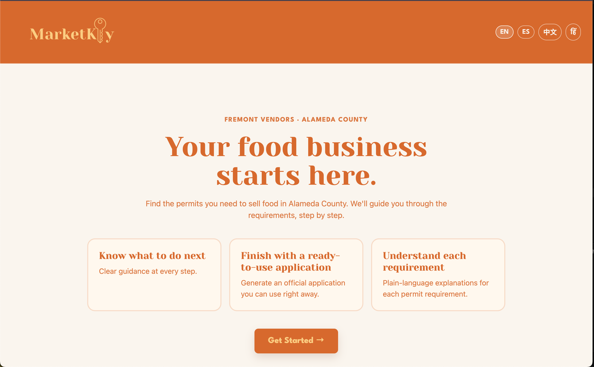

# MarketKey



**Simplifying health permit applications for food vendors in Fremont and Alameda County through accessible, multilingual civic technology.**

MarketKey is a web-based permit helper that transforms complicated food facility health permit applications into a guided, plain-language questionnaire. Vendors answer questions about their business and receive a completed county PDF application at the end.

**[Try MarketKey Live](https://marketkey-one.vercel.app/)**

---

## Why We Built It

Small food businesses often face complicated government terminology, branching requirements, and multiple disconnected PDF pages when trying to determine which health permits they need.

For first-time vendors, understanding the difference between permit categories such as a Temporary Food Facility (TFF) and a Mobile Food Facility can be particularly challenging.

We built MarketKey to make this process easier to navigate. By translating complicated requirements into straightforward questions and organizing them into a guided workflow, MarketKey helps vendors understand the application process while preserving the official county application format.

## Core Features

- **Guided Questionnaire:** A 58-question workflow uses plain language and routes vendors through relevant permit questions.
- **Multilingual Accessibility:** Supports English, Spanish, Mandarin, and Hindi. Interface labels are localized while stored answers retain canonical English values for consistent PDF field mapping.
- **Automated PDF Generation:** Uses `pdf-lib` to populate the official county PDF template directly in the browser.
- **Digital Signature:** Allows users to draw and embed their signature into the generated application.
- **Two-Layer Interface:** Introduces visitors to the project through an overview before opening the five-step application workflow.
- **Client-Side Processing:** Handles application form data in the browser without requiring a backend database for application submissions.

## How It Works

MarketKey combines a guided questionnaire with browser-based PDF generation.

1. **Choose a language:** Vendors select from the available interface languages.
2. **Complete the questionnaire:** The application presents relevant questions in a structured workflow.
3. **Process responses:** JavaScript manages application state, validates responses, and maps canonical answer values to the corresponding PDF fields.
4. **Generate the application:** `pdf-lib` fills the official PDF template and embeds the vendor's signature.
5. **Download the PDF:** The completed application is generated and made available for download.

## Tech Stack & Architecture

MarketKey is built using vanilla JavaScript, HTML5, and CSS3, with `pdf-lib` for PDF manipulation. Utility styles and custom CSS provide the interface without requiring a heavy frontend framework or complex build process.

### Technologies

| Technology | Purpose |
|---|---|
| HTML5 | Application structure |
| CSS3 | Styling and responsive interface |
| JavaScript | Application logic, routing, validation, and state management |
| JSON | Questionnaire definitions and localized prompts |
| pdf-lib | Browser-based PDF generation and form filling |
| Vercel | Application deployment |

### Project Structure

The main application files are organized under `main code/`:

```text
MarketKey/
├── main code/
│   ├── index.html
│   ├── script.js
│   ├── style.css
│   ├── questions.json
│   └── assets/
│       └── tff-application.pdf
├── marketkey-screenshot.png
├── LICENSE
└── README.md
```

### Development Branches

Branches prefixed with `feature/` are experimental testing and development branches. They may contain prototypes or work in progress and are not necessarily integrated into the stable `main` branch or included in the live deployment. The `main` branch represents the primary version of MarketKey.

## Getting Started

### Prerequisites

- Python 3 installed on your computer.
- A modern web browser.
- Git installed to clone the repository.

### Run Locally

MarketKey does not require a frontend build process.

**1. Clone the repository:**
git clone https://github.com/aksharabharath/MarketKey.git

**2. Navigate to the application directory:**
cd MarketKey/"main code"

**3. Start a local development server:**
python3 -m http.server 8000

**4. Open the application in your browser:**
http://localhost:8000

To stop the server, press `Control + C` in your terminal.

### Live Demo

You can also access the deployed application without installing anything:

**[https://marketkey-one.vercel.app/](https://marketkey-one.vercel.app/)**

## Privacy & Data Handling

MarketKey is designed to minimize the need for external storage of sensitive vendor information.

- Application form data is processed on the client side.
- The application does not require a backend database to process or generate submissions.
- Local draft state keeps answers available during the application session.
- PDF generation takes place directly in the user's browser.

Users should review their completed application before downloading or submitting it.

## Important Disclaimer

MarketKey is an independent project designed to help food vendors navigate the county application process.

It is not affiliated with or endorsed by Alameda County. It does not issue permits, determine official eligibility, or guarantee application approval.

Vendors should consult the appropriate county department for current requirements and official submission instructions. The generated PDF should be reviewed for accuracy before submission.

## Team

**MarketKey Team**

- Akshara Bharath
- Sharayu Patil
- Sriya Lingam

## Recognition

MarketKey won the **Congressional App Challenge**, recognizing its approach to using technology to address a real-world community problem.

## License

The original MarketKey source code is released under the [MIT License](LICENSE).

The official county PDF template and other third-party materials may be subject to separate ownership and usage terms. The MIT License does not automatically grant rights to those materials.

---

**Built to make local food business permitting more accessible, understandable, and approachable.**